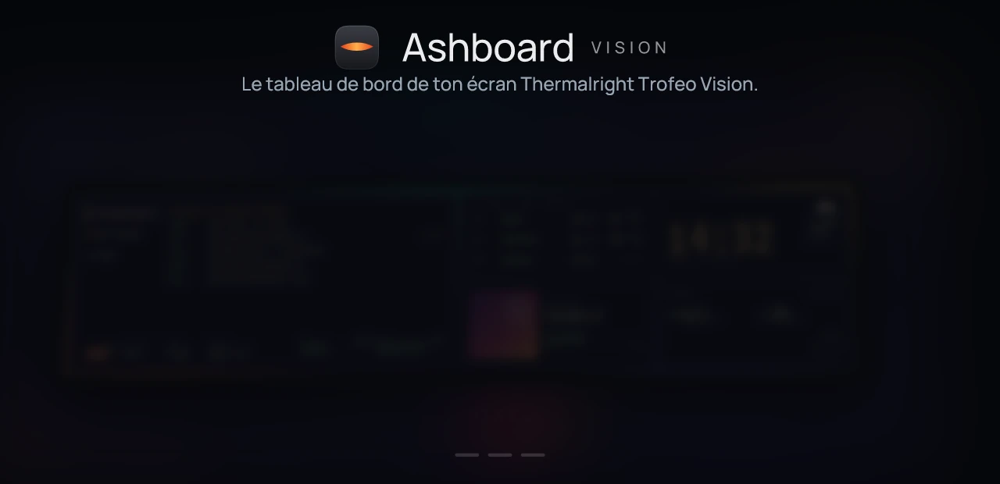
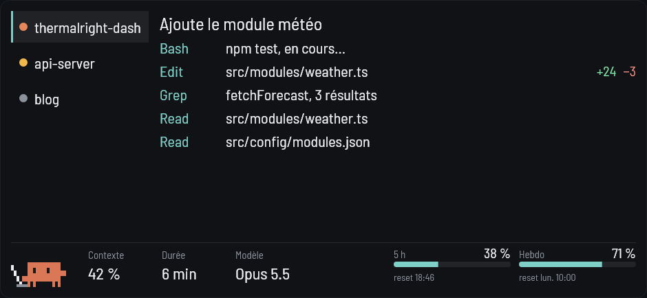
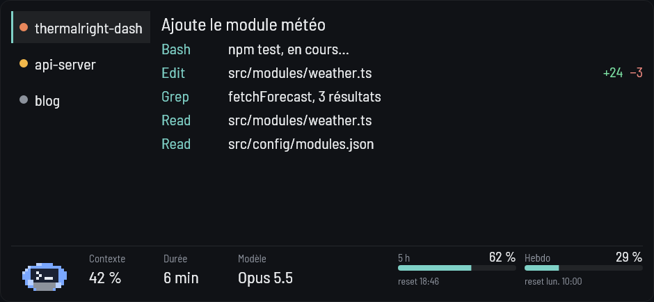
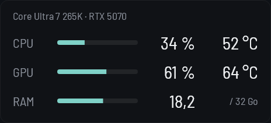
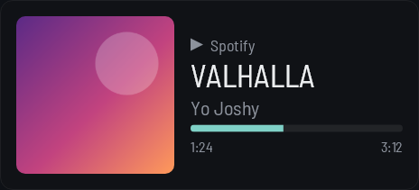
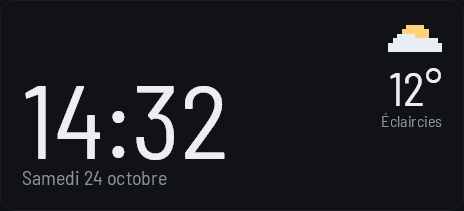
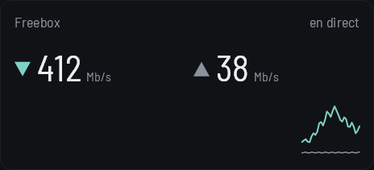

<h1 align="center">
  
</h1>

<p align="center">
  <a href="https://github.com/Ashewos/ashboard-vision/releases/latest"></a>
  <a href="https://github.com/Ashewos/ashboard-vision/releases"></a>
  
  <a href="LICENSE"></a>
  <a href="https://github.com/Ashewos/ashboard-vision/releases"></a>
</p>

<p align="center">
  <a href="#modules">Modules</a> •
  <a href="#installation">Installation</a> •
  <a href="#stable-et-bêta">Stable et Bêta</a> •
  <a href="#écrans-compatibles">Écrans compatibles</a> •
  <a href="#questions-fréquentes">Questions</a> •
  <a href="#crédits">Crédits</a>
</p>

<p align="center">
  <a href="https://github.com/Ashewos/ashboard-vision/releases/latest"></a>
</p>

<p align="center">
  <sub>Envie d'essayer les nouveautés en avance ? Les bêtas sont dans la <a href="https://github.com/Ashewos/ashboard-vision/releases">liste des versions</a>.</sub>
</p>

## Ce que fait Ashboard Vision

Ashboard Vision fait du Thermalright Trofeo Vision 9,16" (1920 × 462) un tableau de bord pour ton PC, sous Windows. Tu poses des modules sur un damier de 16 × 4 cases : l'heure et la météo, l'état du PC, le morceau en cours, le réseau, tes sessions Claude Code ou Codex. Tu choisis ceux que tu gardes, leur taille et leur place, puis le thème et le fond d'écran.

- Le logiciel parle directement à l'écran, sans TRCC (le logiciel de Thermalright) et sans pilote à installer.
- Il reprend tout seul quand tu débranches l'écran, quand le PC se met en veille ou quand un autre programme fige l'écran.
- Une icône dans la zone de notification donne l'état de l'écran. Un double-clic ouvre les réglages : disposition, thèmes, modules, raccourcis clavier, mises à jour.
- Des raccourcis clavier globaux changent d'onglet dans les modules Claude Code et Codex : `Ctrl+Alt+←` et `Ctrl+Alt+→`, ou `Ctrl+Alt+Maj+1` à `9` (voir [les raccourcis](docs/utilisation-avancee.md#raccourcis-clavier)).
- Il reste discret : de l'ordre de 0,3 à 0,4 % du processeur et 40 à 50 Mo de mémoire, sans fond vidéo.
- Trois thèmes (Classique, Liquid Glass, Pixel), la transparence des modules, la police, et un fond en couleur, en image, en GIF ou en vidéo.

Le détail des réglages se trouve dans [l'utilisation avancée](docs/utilisation-avancee.md).

## Modules

<table>
  <tr>
    <td width="50%"><b>Claude Code</b><br><br>Un onglet par session ouverte (appli desktop ou terminal), le fil de son activité, une mascotte animée, le contexte et les quotas.</td>
    <td width="50%"><b>Codex</b><br><br>Le même module pour Codex. Tu l'ajoutes depuis l'onglet Disposition de la fenêtre de réglage, à la place de Claude Code ou à côté.</td>
  </tr>
  <tr>
    <td width="50%"><b>Monitoring PC</b><br><br>Processeur, carte graphique et mémoire, avec leurs températures.</td>
    <td width="50%"><b>En écoute</b><br><br>Le titre, la pochette et la progression du média en cours dans Windows.</td>
  </tr>
  <tr>
    <td width="50%"><b>Heure et météo</b><br><br>La date, l'heure en 24 h ou 12 h et la météo du lieu que tu choisis.</td>
    <td width="50%"><b>Réseau</b><br><br>Le débit de la carte réseau de ton PC, d'une Freebox ou d'une console UniFi.</td>
  </tr>
</table>

Les captures sont en thème Classique : chaque module prend les couleurs du thème que tu choisis.

## Installation

1. **Télécharge** `Ashboard-Vision-Setup-<version>.exe` dans la [dernière version](https://github.com/Ashewos/ashboard-vision/releases/latest), sous « Assets ».
2. **Lance-le.** Windows affiche peut-être l'écran bleu « Windows a protégé votre ordinateur » : l'installateur n'est pas signé numériquement, donc Windows ne connaît pas son éditeur. Ce n'est pas un signe de danger en soi, mais c'est à toi de décider si tu fais confiance à ce fichier (voir « Vérifier le fichier » plus bas). Pour continuer :
   1. clique sur **Informations complémentaires** ;
   2. puis sur **Exécuter quand même**.
3. **Accepte l'autorisation administrateur** que Windows demande : l'installateur copie les fichiers dans `Program Files` et peut installer le pilote des températures.
4. **Suis les pages** : bienvenue, licence, dossier d'installation, puis les options :
   - un raccourci sur le bureau ;
   - démarrer avec Windows ;
   - installer le pilote des températures du processeur (PawnIO), coché par défaut. L'installateur le télécharge pendant l'installation : une connexion Internet est requise pour cette option. Sans connexion, l'installation se fait quand même, sans le pilote.
5. **Termine** en laissant cochée la case « Lancer Ashboard Vision ». Au premier lancement, un assistant te guide : écran, orientation, modules, Claude Code, réseau, météo, capteurs, démarrage.

**Ferme TRCC** avant de brancher l'écran : un seul programme à la fois peut parler à l'écran.

### Vérifier le fichier

Chaque version est construite par GitHub à partir du code de ce dépôt, tests compris, puis publiée avec l'empreinte SHA-256 de l'installateur (`Ashboard-Vision-Setup-<version>.exe.sha256`). Pour la comparer, dans PowerShell, depuis le dossier du téléchargement :

```powershell
Get-FileHash .\Ashboard-Vision-Setup-<version>.exe -Algorithm SHA256
```

### Mises à jour

Le logiciel regarde les versions publiées sur GitHub une minute après son démarrage, puis une fois par jour. Quand une version est disponible, l'icône de notification et la fenêtre de réglage te le disent. Un clic la télécharge et vérifie son empreinte ; Windows demande alors l'autorisation administrateur, l'installateur fait le reste sans page et relance le logiciel.

### Désinstallation

Désinstalle Ashboard Vision depuis les **Applications installées** de Windows. La désinstallation te demande si tu gardes ou si tu effaces tes réglages (disposition, jetons, clés). Le pilote PawnIO reste installé, parce que d'autres logiciels peuvent s'en servir.

Limite : si l'autorisation administrateur est donnée par un autre compte que le tien, la désinstallation ne nettoie les réglages, le démarrage avec Windows et le mod des quotas que pour le compte qui la lance. C'est rare sur un PC personnel.

## Stable et Bêta

Le logiciel suit un de ces deux canaux, au choix dans **Paramètres, section Mises à jour, « Version »**.

| | Stable | Bêta |
|---|---|---|
| Pour qui | Tout le monde : c'est le choix par défaut. | Ceux qui veulent les nouveautés avant tout le monde. |
| Ce que tu reçois | Les versions publiées, testées sur l'écran. | Les préversions (`1.1.0-beta.1`…) et les versions stables. |
| Risque | Faible. | Une bêta peut avoir des défauts. |

Pour repasser de Bêta à Stable, le logiciel installe tout de suite la dernière version stable, en te prévenant que des réglages enregistrés par la bêta pourraient mal se relire : une copie de tes réglages est faite avant. Si tu préfères garder ta bêta jusqu'à la prochaine stable, coche **« Attendre la prochaine version stable »**.

## Écrans compatibles

Pour l'instant, un seul : le **Thermalright Trofeo Vision 9,16"** (1920 × 462), qui s'annonce en USB `0416:5408` (modèle 65 dans sa poignée de main).

Si l'écran branché est un autre produit Thermalright, le logiciel le reconnaît quand c'est possible et te dit clairement qu'il n'est pas encore pris en charge, au lieu d'essayer de l'utiliser. D'autres modèles viendront dans de prochaines versions. Les notes sur ce qu'on sait des autres écrans sont dans [`docs/superpowers/notes/2026-10-29-ecrans-thermalright.md`](docs/superpowers/notes/2026-10-29-ecrans-thermalright.md).

## Questions fréquentes

**L'écran reste sur le logo Thermalright.**
Ferme TRCC, puis regarde l'icône dans la zone de notification : elle indique si le service tourne et si l'écran répond. Le logiciel renvoie l'image chaque seconde ; sans lui, l'écran retourne au logo au bout de 3 s environ.

**Windows dit « Windows a protégé votre ordinateur ».**
C'est l'écran SmartScreen, qui s'affiche pour tout fichier non signé. Ce projet n'a pas de signature de code : un certificat est payant, et la signature par une fondation ferait apparaître quelqu'un d'autre que l'auteur comme éditeur. Les étapes pour continuer sont dans [Installation](#installation).

**Le module Monitoring affiche « Temp. CPU : installe le pilote ».**
Windows ne laisse lire les températures du processeur qu'à un programme élevé, avec un pilote. Relance l'installateur (avec une connexion Internet, car il télécharge le pilote) et coche l'option du pilote des températures (PawnIO) : il installe aussi l'assistant des capteurs. Tu peux aussi le faire depuis la fenêtre de réglage (Paramètres, Températures du processeur). La ligne disparaît dès que la température arrive.

**Le module Claude Code affiche « Quotas indisponibles ».**
Les quotas viennent d'un petit mod de Claude Code, `ashboard-quotas`, que tu installes depuis les réglages du module (ou l'assistant du premier lancement). Il faut que la commande `claude` soit accessible depuis ton compte. Le mod ne voit que les réponses reçues sur ce PC : ce que tu consommes ailleurs (le chat sur le web, par exemple) n'apparaît qu'à la prochaine réponse locale.

**Où sont mes réglages ?**
Dans `%AppData%\ashboard-vision` : `layout.json` pour la disposition et le thème, `logs\display.log` pour le journal. Tu peux aussi exporter et importer ta disposition depuis les réglages. Si tu utilisais une version d'avant le changement de nom, le logiciel déplace tes réglages au premier lancement.

**Peut-on le désinstaller proprement ?**
Oui, depuis les Applications installées de Windows (voir [Désinstallation](#désinstallation)).

**Je veux régler quelque chose à la main.**
Tout est dans [l'utilisation avancée](docs/utilisation-avancee.md) : réglages du module Claude Code et Codex, fonds animés, garde de lisibilité, commandes de vérification de l'écran.

## Crédits

Le protocole de l'écran a été compris grâce à ces projets :

- [Lexonight1/thermalright-trcc-linux](https://github.com/Lexonight1/thermalright-trcc-linux) (GPL-3.0)
- [sukualam/trofeo-lcd](https://github.com/sukualam/trofeo-lcd)
- [haven80/trofeo-lcd-rs](https://github.com/haven80/trofeo-lcd-rs)
- [JuliusNarvasa/TrofeoVision](https://github.com/JuliusNarvasa/TrofeoVision)
- [CraigyBabyJ/lcd_therma](https://github.com/CraigyBabyJ/lcd_therma)

Les relevés de capteurs viennent de [LibreHardwareMonitor](https://github.com/LibreHardwareMonitor/LibreHardwareMonitor) (MPL-2.0), qui s'appuie sur le pilote [PawnIO](https://pawnio.eu/) pour les températures du processeur.

La lecture des fonds vidéo passe par [Vortice.MediaFoundation](https://github.com/amerkoleci/Vortice.Windows) (MIT), qui s'appuie sur [SharpGen.Runtime](https://github.com/SharpGenTools/SharpGenTools) (MIT) ; ses autres dépendances, Vortice.DirectX et Vortice.Mathematics, sont aussi sous licence MIT.

La fenêtre de réglage est faite avec [Avalonia](https://github.com/AvaloniaUI/Avalonia) (MIT).

Données météo : [Open-Meteo.com](https://open-meteo.com/) (CC BY 4.0).

Mascottes : redessins de fan de Clawd (Anthropic) et du pet Codex (OpenAI).

Polices embarquées, les quatre familles des thèmes (Barlow Semi Condensed, Manrope, Pixelify Sans et VT323), toutes sous licence SIL Open Font License 1.1 (OFL) : le texte de chaque licence est dans [`src/Trofeo.Core/Assets/Fonts/`](src/Trofeo.Core/Assets/Fonts/) (dossier `Assets/Fonts`) et copié à côté du programme :

- Barlow Semi Condensed : `OFL-BarlowSemiCondensed.txt` ;
- Manrope : `OFL-Manrope.txt` ;
- Pixelify Sans : `OFL-PixelifySans.txt` ;
- VT323 : `OFL-VT323.txt`.

Manrope et Pixelify Sans, publiées en police variable, sont embarquées en une graisse fixe (Medium et Regular).

## Licence

[GPL-3.0](LICENSE).

## Avertissement

Projet de fan, non affilié à Thermalright, Anthropic ni OpenAI. Les noms et marques cités appartiennent à leurs propriétaires. Les mascottes sont des redessins de fan.
